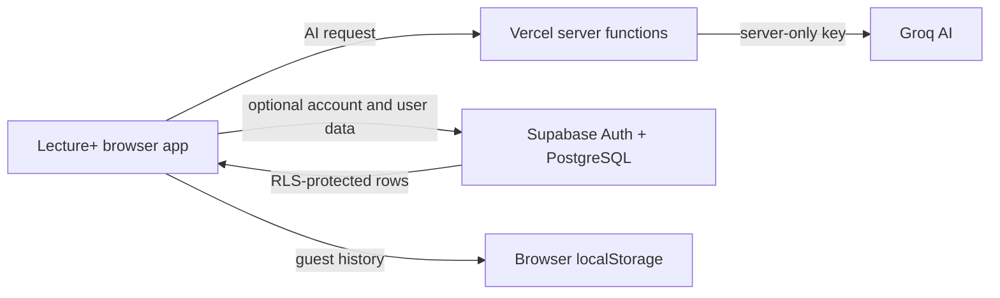

# Lecture+ Supabase, Profile, and Database Assignment Design

**Date:** 2026-10-12  
**Status:** Ready for implementation review  
**Team:** Askat, Merei, Asyl, Zangarbek

## 1. Goal

Extend Lecture+ with a real cloud database while keeping the current presentation flow simple. Anyone can open the site and analyze a lecture without an access code or account. A student may create an account to save lecture history, quiz results, tasks, reminders, and future-topic predictions across devices.

The same database design must support the Week 6 assignment: business rules, an ER diagram, an editable diagram source, one verified scenario, and the contribution of all four team members.

## 2. Scope

The implementation includes:

- Supabase PostgreSQL on the Free plan;
- optional Supabase email/password authentication;
- cloud synchronization for signed-in users;
- a complete Profile and History page;
- a public Database Demo page for the professor;
- 12 application tables with meaningful relationships;
- row-level security so each user sees only their own data;
- a DBML source file and ER diagram image;
- an English B1 Word document for the assignment;
- deployment to the existing Vercel project.

The Groq API remains behind Vercel server functions. Its secret key is never sent to the browser or stored in Supabase.

## 3. Main user flows

### 3.1 Guest student

1. Opens Lecture+ without an access code.
2. Records or uploads lecture audio, or enters text.
3. Receives the transcript, explanation, current topics, predicted future topics, quiz, tasks, and reminders.
4. The result is saved in browser local storage.
5. The student may open Profile to see local history or sign in to sync it.

### 3.2 Signed-in student

1. Signs up or signs in with email and password.
2. Chooses whether to import existing local history.
3. New lecture results are stored in Supabase.
4. Profile shows searchable history, quiz progress, task status, and full lecture details.
5. The same history becomes available on another device after sign-in.

### 3.3 Professor

1. Opens the public Database Demo page from the website or assignment document.
2. Sees the 12 tables, primary and foreign keys, relationships, business rules, and a fixed demonstration scenario.
3. Sees a safe database connection indicator and aggregate demo counts.
4. Opens the editable DBML source link. No real student data is publicly shown.

## 4. Architecture

The browser uses the Supabase publishable key, which is safe to expose when Row Level Security is enabled. The Supabase service-role key, if needed for administrative setup, stays outside the browser and is never committed. User-owned CRUD should use the browser client and RLS rather than a service-role endpoint.

## 5. Database schema

Supabase `auth.users` stores authentication identities. It is a platform table and is not counted among the 12 application tables.

### 5.1 `profiles`

- `id uuid` PK, FK to `auth.users.id`, cascade delete
- `display_name text` not null
- `email text` not null
- `avatar_url text` nullable
- `cloud_sync_enabled boolean` default false
- `created_at timestamptz` default now
- `updated_at timestamptz` default now

### 5.2 `lectures`

- `id uuid` PK
- `user_id uuid` FK to `profiles.id`, cascade delete
- `title text` not null
- `source_type text` check: `audio`, `file`, or `text`
- `source_name text` nullable
- `language text` default `en`
- `duration_seconds integer` nullable, non-negative
- `status text` check: `processing`, `ready`, or `failed`
- `created_at timestamptz` default now
- `updated_at timestamptz` default now

### 5.3 `transcripts`

- `id uuid` PK
- `lecture_id uuid` unique FK to `lectures.id`, cascade delete
- `content text` not null
- `word_count integer` default 0, non-negative
- `detected_language text` nullable
- `created_at timestamptz` default now

### 5.4 `analyses`

- `id uuid` PK
- `lecture_id uuid` unique FK to `lectures.id`, cascade delete
- `summary text` not null
- `key_points jsonb` default `[]`
- `explanation_sections jsonb` default `[]`
- `recommended_actions jsonb` default `[]`
- `model_name text` nullable
- `created_at timestamptz` default now

### 5.5 `topics`

- `id uuid` PK
- `name text` unique not null
- `description text` nullable
- `created_at timestamptz` default now

### 5.6 `lecture_topics`

- `id uuid` PK
- `lecture_id uuid` FK to `lectures.id`, cascade delete
- `topic_id uuid` FK to `topics.id`, restrict delete
- `role text` check: `current` or `future`
- `reason text` nullable
- `confidence numeric(4,3)` nullable, between 0 and 1
- unique constraint on `lecture_id`, `topic_id`, and `role`

### 5.7 `questions`

- `id uuid` PK
- `lecture_id uuid` FK to `lectures.id`, cascade delete
- `question_text text` not null
- `explanation text` nullable
- `position integer` not null, non-negative
- `created_at timestamptz` default now

### 5.8 `answer_options`

- `id uuid` PK
- `question_id uuid` FK to `questions.id`, cascade delete
- `option_text text` not null
- `is_correct boolean` default false
- `position integer` not null, non-negative

### 5.9 `quiz_attempts`

- `id uuid` PK
- `user_id uuid` FK to `profiles.id`, cascade delete
- `lecture_id uuid` FK to `lectures.id`, cascade delete
- `score integer` default 0, non-negative
- `total_questions integer` default 0, non-negative
- `completed_at timestamptz` default now

### 5.10 `attempt_answers`

- `id uuid` PK
- `attempt_id uuid` FK to `quiz_attempts.id`, cascade delete
- `question_id uuid` FK to `questions.id`, cascade delete
- `selected_option_id uuid` FK to `answer_options.id`, restrict delete
- `is_correct boolean` not null
- unique constraint on `attempt_id` and `question_id`

### 5.11 `tasks`

- `id uuid` PK
- `lecture_id uuid` FK to `lectures.id`, cascade delete
- `title text` not null
- `description text` nullable
- `task_type text` check: `teacher` or `ai_practice`
- `due_at timestamptz` nullable
- `is_completed boolean` default false
- `created_at timestamptz` default now

### 5.12 `reminders`

- `id uuid` PK
- `task_id uuid` FK to `tasks.id`, cascade delete
- `remind_at timestamptz` not null
- `channel text` check: `in_app` or `calendar`
- `status text` check: `planned`, `sent`, or `dismissed`
- `created_at timestamptz` default now

## 6. Relationship rules

1. One authenticated user has one profile.
2. One profile can own many lectures and quiz attempts.
3. One lecture has at most one transcript and one analysis.
4. A lecture can have many current and future topics; a topic can belong to many lectures.
5. One lecture can have many quiz questions; each question has two or more answer options and exactly one correct option.
6. One quiz attempt belongs to one student and one lecture.
7. One attempt can contain one answer for each question.
8. One lecture can have teacher tasks and AI practice tasks.
9. A task may have many reminders.
10. Deleting a lecture deletes its dependent transcript, analysis, topic links, questions, attempts, answers, tasks, and reminders.

## 7. Security and privacy

- AI analysis stays available to guests.
- Cloud saving is off until the student signs in and explicitly enables it.
- The permission text near audio recording explains that a signed-in student's transcript and result can be saved to Supabase.
- RLS policies compare the row owner with `auth.uid()`.
- Child-table policies verify ownership through the parent lecture or attempt.
- `topics` may be read by authenticated users, while inserts happen only as part of an owned lecture save flow.
- The Database Demo uses fixed sample content and metadata. It never exposes transcripts, email addresses, or other user rows.
- Groq and Supabase administrative secrets stay in Vercel environment variables and local ignored files.

## 8. Profile and History page

The page uses the current Lecture+ visual language and contains:

- profile name and email;
- statistics: lecture count, average quiz score, completed tasks;
- search by lecture title or topic;
- date filter;
- lecture cards with date, source, current topics, predicted topics, quiz score, and task progress;
- a details view with transcript, full analysis, quiz review, tasks, and reminders;
- delete action for a lecture;
- sign-in/sign-up panel when logged out;
- `Import local history` action after first sign-in;
- sign-out action.

Guests continue to see their current local history. Authentication problems must not block the AI demo.

## 9. Local-to-cloud synchronization

1. Existing localStorage records remain readable.
2. After sign-in, the user chooses whether to import local records.
3. Imported records receive stable client-generated UUIDs so repeated imports do not create duplicates.
4. Cloud save writes one complete lecture graph in dependency order: lecture, transcript, analysis, topics, questions/options, tasks/reminders.
5. If cloud save fails, the local copy remains and the UI shows a retry action.
6. A successful cloud save records the cloud lecture ID in the local item.
7. Cloud history is the main source for a signed-in user; unsynced local items appear with a visible pending state.

## 10. Database Demo page

The public page includes:

- an ER diagram;
- 12 table cards with PK and FK labels;
- a relationship list and business rules;
- a fixed scenario called `From lecture to learning plan`;
- a connection badge based on a safe read-only database check;
- aggregate counts from dedicated safe views or fixed demo rows;
- a link to the editable `.dbml` source in the public repository or deployed source page.

The scenario demonstrates: one student saves a lecture, the system stores its transcript and analysis, marks current and future topics, creates a quiz, stores the attempt, and creates tasks with reminders.

## 11. Assignment document

The Word document is written in simple English at B1 level and contains:

1. project and database purpose;
2. business rules;
3. ER diagram image;
4. link to the editable diagram source;
5. explanation of the 12 tables and key relationships;
6. scenario verification with expected database rows;
7. team contribution.

Initial team contribution:

- **Askat:** system architecture, database logic, and integration;
- **Merei:** business rules and table descriptions;
- **Asyl:** ER diagram and relationship checking;
- **Zangarbek:** scenario verification and document layout;
- **All members:** final review and presentation preparation.

## 12. Error handling

- Supabase unavailable: keep the result locally and offer retry.
- Session expired: keep data locally, ask the user to sign in again, and do not lose the analysis.
- Duplicate import: update or skip by stable UUID.
- Partial cloud write: use a PostgreSQL function/transaction for the complete lecture graph where practical; otherwise clean up the incomplete parent and retry.
- Invalid relationship data: enforce checks, unique constraints, and foreign keys in PostgreSQL.
- Empty history: show a clear action to analyze the first lecture.

## 13. Verification

Implementation is complete when:

- the existing guest AI flow still works without an access code;
- a user can sign up, sign in, sign out, and enable cloud sync;
- an analysis creates correctly related rows in all applicable tables;
- a signed-in user can see the saved lecture on another browser session;
- local history import does not duplicate rows;
- quiz attempts and task completion update Profile statistics;
- one user cannot read or change another user's data;
- the public Database Demo shows the ER design without exposing user data;
- the Word document opens correctly and includes every teacher requirement;
- production build, automated tests, and deployment smoke checks pass.

## 14. Rollout order

1. Create Supabase project and environment variables.
2. Add SQL schema, indexes, triggers, functions, and RLS policies.
3. Add Supabase client and optional authentication UI.
4. Add cloud save, history import, and sync status.
5. Build Profile and full History details.
6. Build Database Demo and editable DBML source.
7. Generate and visually verify the ER diagram and Word document.
8. Test security, core flows, and production deployment.

